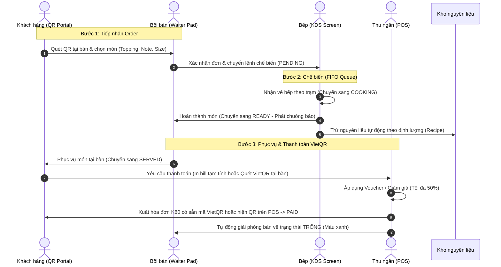

# 🍽️ POS Restaurant Management System

[](https://nodejs.org/)
[](https://expressjs.com/)
[](https://www.typescriptlang.org/)
[](https://webpack.js.org/)
[](https://www.mongodb.com/)
[](https://tailwindcss.com/)
[](https://vietqr.io/)
[-success.svg)]()
[](LICENSE)

> **Hệ thống Quản lý Nhà hàng & Bán hàng Đa phân hệ Toàn diện (All-in-One Restaurant POS)**  
> Tích hợp đồng bộ từ **Khách hàng gọi món qua QR (Self-ordering)**, **Bồi bàn phục vụ (Waiter Floor)**, **Màn hình bếp thông minh (Kitchen Display System - KDS)**, **Thu ngân thanh toán (Cashier POS) với VietQR động**, đến **Trung tâm Quản trị & Báo cáo Lãi/Lỗ P&L (Admin Hub)**.

---

## 📑 Mục Lục
1. [Tổng Quan Dự Án](#-tổng-quan-dự-án)
2. [Kiến Trúc & Vòng Đời Đơn Hàng](#-kiến-trúc--vòng-đời-đơn-hàng)
3. [Tính Năng Nổi Bật Theo Phân Hệ](#-tính-năng-nổi-bật-theo-phân-hệ)
4. [Kiến Trúc Máy Chủ Kép (Dual-Backend Architecture)](#-kiến-trúc-máy-chủ-kép-dual-backend-architecture)
5. [Công Nghệ Sử Dụng](#-công-nghệ-sử-dụng)
6. [Cấu Trúc Thư Mục](#-cấu-trúc-thư-mục)
7. [Hướng Dẫn Cài Đặt & Khởi Chạy](#-hướng-dẫn-cài-đặt--khởi-chạy)
8. [Tài Khoản Kiểm Thử Mẫu](#-tài-khoản-kiểm-thử-mẫu)
9. [Danh Mục RESTful API](#-danh-mục-restful-api)
10. [Kịch Bản Kiểm Thử Tự Động](#-kịch-bản-kiểm-thử-tự-động)
11. [Tác Giả & Giấy Phép](#-tác-giả--giấy-phép)

---

## 🌟 Tổng Quan Dự Án

Hệ thống **POS Restaurant** được thiết kế nhằm số hóa toàn diện quy trình vận hành của nhà hàng F&B hiện đại. Dự án giải quyết triệt để các bài toán thực tế:
- **Tốc độ & Tính chính xác**: Khách hàng quét mã QR tại bàn để tự gọi món hoặc bồi bàn order trực tiếp trên máy tính bảng; dữ liệu tức thì được định tuyến đến đúng trạm bếp theo nguyên tắc FIFO.
- **Thanh toán VietQR động 2 chiều (Dynamic VietQR)**: Tích hợp mã QR chuẩn NAPAS 247 trên hóa đơn in nhiệt K80 và màn hình thanh toán trực tuyến, khách quét là tự động điền số tiền và thông tin bàn ăn.
- **Minh bạch tài chính & Tiền két**: Phân hệ thu ngân quản lý ca làm việc nghiêm ngặt (mở ca, kiểm tiền thực tế, đối soát lệch két, ghi nhận giao dịch thu/chi phát sinh).
- **Kiểm soát chiết khấu**: Tích hợp thuật toán khống chế mức giảm giá Combo và giảm giá hóa đơn **không vượt quá 50%**, hiển thị cảnh báo đỏ trực quan ngăn ngừa thất thoát.
- **Tự động hóa kho & Định lượng (BOM)**: Tự động trừ kho nguyên liệu thô theo công thức món ăn (Recipe) ngay khi bếp hoàn thành chế biến.
- **Kiến trúc Máy chủ kép (Dual-Backend)**: Hỗ trợ linh hoạt cả Backend Node.js/MongoDB đầy đủ lẫn chế độ Standalone JSON-Server chạy ngay tức thì không cần cài database.

---

## 🔄 Kiến Trúc & Vòng Đời Đơn Hàng

### Luồng Vận Hành Vòng Đời Đơn Hàng (Order Lifecycle)



---

## 🎯 Tính Năng Nổi Bật Theo Phân Hệ

### 1. Phân Hệ Khách Hàng Gọi Món (Customer QR Portal)
- **Truy cập không cần cài đặt**: Quét mã QR tại bàn mở ngay Web App trên trình duyệt di động (`/views/customer/index.html?table=01`).
- **Header tối giản (Minimalist Icon-only Header)**: Thiết kế thanh điều hướng phía trên gọn nhẹ với cụm icon thông minh (gọi nhân viên, xem lịch sử gọi món, yêu cầu tính tiền) kèm **Badge số bàn nổi bật**, nhường trọn vẹn không gian hiển thị hình ảnh món ăn sắc nét.
- **Thực đơn trực quan & Bộ lọc nhanh**: Xem ảnh món, giá tiền, mô tả chi tiết, phân loại theo danh mục (Khai vị, Món chính, Tráng miệng, Đồ uống,...).
- **Tùy chỉnh món linh hoạt**: Chọn size, mức đường/đá, thêm topping và ghi chú riêng cho đầu bếp.
- **Thanh toán VietQR trực tuyến tại bàn**: Khách có thể tự bấm nút "Thanh toán QR", popup hiển thị mã VietQR động tự động điền sẵn số tiền chính xác, số bàn và mã đơn hàng. Hệ thống tự động đồng bộ trạng thái sang màn hình thu ngân ngay khi hoàn tất.

### 2. Phân Hệ Nhân Viên Phục Vụ (Waiter Floor Portal)
- **Bản đồ bàn thông minh**: Hiển thị trạng thái màu sắc trực quan theo thời gian thực:
  - 🟢 **Xanh lá**: Bàn trống (Available).
  - 🔴 **Đỏ**: Bàn đang có khách dùng bữa (Occupied).
  - 🟡 **Vàng**: Bàn đang gọi tính tiền (Waiting Payment).
  - ⚪ **Xám**: Bàn đang dọn dẹp (Cleaning).
- **Nghiệp vụ phòng bàn linh hoạt**: Chuyển bàn, gộp bàn của hai nhóm khách, tách hóa đơn độc lập.
- **Nhận order tại bàn**: Thêm món bổ sung, ghi chú hủy món hoặc yêu cầu ưu tiên cho bếp.

### 3. Phân Hệ Màn Hình Bếp Thông Minh (Kitchen Display System - KDS)
- **Hàng đợi FIFO**: Sắp xếp vé món theo thời gian đặt vào trước ra trước, tránh sót món của khách.
- **Định tuyến trạm chế biến**: Phân luồng món ăn theo đúng khu vực: Bếp Nóng, Bếp Lạnh, Quầy Pha Chế.
- **Tiến trình chế biến 3 bước**: `Chờ nấu (PENDING)` $\rightarrow$ `Đang nấu (COOKING)` $\rightarrow$ `Đã hoàn thành (READY)`.
- **Cảnh báo trễ giờ**: Tự động chuyển màu cảnh báo vàng/đỏ và phát âm thanh chuông báo khi đơn hàng chờ quá thời gian quy định.

### 4. Phân Hệ Thu Ngân & Điểm Bán Hàng (Cashier & POS Portal)
- **Mã VietQR động trên Hóa đơn K80**: Khi bấm **"In tạm tính"** hoặc in hóa đơn thanh toán, chân hóa đơn K80 tự động nhúng hình ảnh mã VietQR động chứa chính xác số tiền và số bàn để nhân viên mang ra bàn cho khách quét bằng mọi app ngân hàng (MB, VCB, Techcom, BIDV, MoMo,...).
- **Màn hình thanh toán QR tại quầy**: Chọn phương thức **"Chuyển khoản QR"**, mã VietQR kích thước lớn lập tức hiện trên màn hình POS cho khách quét trực tiếp tại quầy thu ngân.
- **Tự động giải phóng bàn ăn**: Ngay khi bấm "Xác nhận thanh toán", hóa đơn đổi trạng thái `Paid` và bàn ăn lập tức đổi sang màu xanh (Trống) trên sơ đồ.
- **Quản lý ca làm việc (Shifts)**:
  - Bắt buộc nhập tiền lẻ đầu ca khi mở ca (Clock-in).
  - Kiểm đếm tiền mặt thực tế khi đóng ca (Clock-out), tự động đối soát và tính chênh lệch thừa/thiếu.
  - Ghi nhận giao dịch nộp tiền két hoặc rút tiền chi tiêu nội bộ.
- **Khống chế giảm giá tối đa 50%**: Giao diện tự động phát hiện và hiển thị cảnh báo đỏ nổi bật nếu nhân viên nhập mức chiết khấu vượt quá 50% tổng bill, đồng thời khóa thao tác thanh toán sai quy định.

### 5. Trung Tâm Quản Trị Hệ Thống (Admin Management Hub)
- **Quản lý Thực đơn & Danh mục**: Thêm mới, chỉnh sửa thông tin món ăn, hình ảnh, phân loại và giá bán.
- **Trình tạo Combo Thông Minh**:
  - Tự động cộng tổng giá niêm yết các món thành phần.
  - Cho phép thiết lập giá bán combo hoặc phần trăm giảm giá.
  - **Giới hạn chiết khấu tối đa 50%**: Tự động tính toán và hiển thị banner cảnh báo đỏ khi mức giảm vượt ngưỡng 50%, ngăn chặn tạo combo gây lỗ vốn.
- **Quản lý Kho & Định lượng (BOM - Bill of Materials)**:
  - Quản lý danh mục nguyên vật liệu thô (thịt, rau, gia vị,...), đơn vị tính, mức tồn kho an toàn.
  - Thiết lập công thức chế biến (Recipe) cho từng món ăn và biến thể.
  - Tự động trừ kho tức thời khi món được chế biến xong.
  - Báo cáo hao hụt, hỏng hóc và điều chỉnh kiểm kê tồn kho.
- **Báo cáo Tài chính & P&L (Profit & Loss)**: Báo cáo doanh thu, giá vốn bán hàng (COGS), chi phí phát sinh và lợi nhuận ròng theo ngày/tuần/tháng.
- **Phân quyền & Kiểm toán (RBAC & Audit Logs)**: Quản lý tài khoản nhân viên theo vai trò và ghi nhận toàn bộ lịch sử thao tác quan trọng.

---

## ⚡ Kiến Trúc Máy Chủ Kép (Dual-Backend Architecture)

Hệ thống sở hữu bộ điều phối máy chủ thông minh tại [`frontend/server.js`](file:///e:/Hocki5/NodeJS_Restful%20Web%20Service/POS_Restaurant/frontend/server.js) với cơ chế **Smart Proxy & Fallback**:

```text
                               ┌─────────────────────────────┐
                               │   Trình duyệt (Browser)     │
                               │   http://localhost:3000     │
                               └──────────────┬──────────────┘
                                              │
                                              ▼
                             ┌─────────────────────────────────┐
                             │    Smart Proxy (server.js)      │
                             │    Kiểm tra Backend Port 4000   │
                             └────────┬───────────────┬────────┘
                                      │               │
                 [Nếu Port 4000 ONLINE]               [Nếu Port 4000 OFFLINE]
                                      ▼               ▼
                        ┌───────────────────┐   ┌───────────────────┐
                        │  Node.js Express  │   │    JSON-Server    │
                        │     Port 4000     │   │     Port 3000     │
                        │   (MongoDB ORM)   │   │  (Mock Database)  │
                        └───────────────────┘   └───────────────────┘
```

* **Chế độ 1 - Standalone Zero-Config (Cổng 3000)**: Chỉ cần chạy `npm start` trong thư mục `frontend/`. Server tự động đóng vai trò là Web Server phục vụ giao diện tĩnh, đồng thời kích hoạt `json-server` với dữ liệu đầy đủ trong `db.json` và cơ chế Mock Authentication. **Không cần cài đặt hay chạy MongoDB**, cực kỳ thuận tiện để nộp bài, chấm điểm và demo offline!
* **Chế độ 2 - Full-Stack Production (Cổng 4000 + 3000)**: Khi khởi động thêm Backend Node.js tại cổng 4000, `server.js` tự động phát hiện trạng thái online và chuyển tiếp (proxy) toàn bộ API sang Backend thật kết nối MongoDB.
* **Tối ưu tốc độ với SWR Caching**: Sử dụng kỹ thuật Stale-While-Revalidate tải dữ liệu từ bộ nhớ đệm trước rồi cập nhật nền, giúp mở trang và chuyển đổi tab mượt mà dưới 50ms.

---

## 💻 Công Nghệ Sử Dụng

| Tầng công nghệ | Công nghệ / Thư viện chính | Vai trò đảm nhiệm |
| :--- | :--- | :--- |
| **Backend** | `Node.js`, `Express.js` | RESTful API Server, xử lý nghiệp vụ trung tâm |
| **Database** | `MongoDB`, `Mongoose ORM` | Lưu trữ dữ liệu tài liệu linh hoạt, quan hệ tham chiếu schema |
| **Mock Database** | `JSON-Server`, `db.json` | Cung cấp backend độc lập cho môi trường demo và chấm bài |
| **Frontend** | `TypeScript`, `Webpack 5` | SPA Architecture, biên dịch module và type-safe UI logic |
| **Thanh toán** | `VietQR API`, `NAPAS 247` | Sinh mã QR động chuẩn ngân hàng theo đơn hàng và số bàn |
| **Styling & Icons**| `TailwindCSS`, `FontAwesome 6` | Giao diện hiện đại, tối ưu hiển thị Mobile/Tablet/Desktop |
| **Authentication** | `JSON Web Tokens (JWT)`, `Bcryptjs` | Xác thực người dùng, bảo mật mật khẩu và phân quyền RBAC |
| **Automated Test** | `Python (Requests)`, `Node.js` | Kịch bản kiểm thử API tự động theo vai trò và vòng đời đơn |

---

## 📂 Cấu Trúc Thư Mục

```text
POS_Restaurant/
├── backend/                              # Mã nguồn RESTful API Backend (Port 4000)
│   ├── bin/www                           # File khởi chạy HTTP Server
│   ├── config/                           # Cấu hình kết nối MongoDB
│   ├── controllers/                      # Điều hướng nghiệp vụ (Auth, Cashier, Order, Menu, Inventory...)
│   ├── middlewares/                      # Middleware authen.js (Xác thực JWT Token)
│   ├── models/                           # 20 Mongoose Schemas & Models
│   ├── routes/                           # Khai báo các API Endpoints
│   ├── scripts/                          # Script khởi tạo dữ liệu mẫu (seed_western_restaurant_full.js)
│   └── package.json
├── frontend/                             # Giao diện & Máy chủ thông minh (Port 3000)
│   ├── server.js                         # Máy chủ kép: Smart Proxy + JSON-Server fallback
│   ├── db.json                           # Cơ sở dữ liệu mẫu độc lập cho JSON-Server
│   ├── public/                           # Tài nguyên tĩnh & Trang giao diện HTML
│   │   ├── css/                          # Stylesheets tùy chỉnh
│   │   ├── js/                           # Bundle JavaScript đã biên dịch từ TypeScript
│   │   ├── views/
│   │   │   ├── auth/login.html           # Trang Đăng nhập & Đăng ký tài khoản
│   │   │   ├── customer/index.html       # Cổng gọi món Khách hàng qua QR (VietQR online)
│   │   │   └── staff/
│   │   │       ├── admin.html            # Bảng điều khiển Quản trị viên
│   │   │       ├── cashier.html          # Bàn làm việc Thu ngân POS (VietQR in Bill)
│   │   │       ├── waiter.html           # Ứng dụng Bồi bàn phục vụ tại bàn
│   │   │       └── kitchen.html          # Màn hình điều phối Bếp (KDS)
│   │   └── index.html                    # Trang điều hướng trung tâm
│   ├── src/                              # Mã nguồn TypeScript gốc
│   │   ├── admin.ts, admin_menu.ts...    # Logic Quản trị viên & Khống chế Combo <= 50%
│   │   ├── cashier.ts                    # Logic Thu ngân, VietQR, chiết khấu & đối soát ca
│   │   ├── waiter.ts                     # Sơ đồ bàn thời gian thực & đặt món
│   │   ├── kitchen.ts                    # Hàng đợi FIFO & chuyển trạng thái bếp
│   │   ├── customer.ts                   # Menu QR, giỏ hàng & modal thanh toán VietQR
│   │   ├── login.ts, auth.ts             # Quản lý phiên làm việc & Auth Guards
│   │   └── api.ts                        # HTTP Client kết nối API
│   ├── tsconfig.json                     # Cấu hình biên dịch TypeScript
│   ├── webpack.config.js                 # Cấu hình Webpack 5 đóng gói SPA
│   └── package.json
├── tests/                                # Bộ kiểm thử tự động toàn diện
│   ├── test_full_order_lifecycle.py      # Test tích hợp luồng đơn hàng từ A-Z
│   ├── test_auth_flow.js                 # Test đăng ký, đăng nhập & cấp refresh token
│   ├── test_combo_feature.py             # Test xác minh khống chế giảm giá Combo <= 50%
│   ├── test_role_admin.py                # Test các quyền và tính năng Quản trị viên
│   ├── test_role_cashier.py              # Test nghiệp vụ thu ngân & đóng ca
│   ├── test_role_chef.py                 # Test nghiệp vụ bếp KDS
│   ├── test_role_customer.py             # Test đặt món từ giao diện khách hàng
│   └── test_role_waiter.py               # Test nghiệp vụ phục vụ & phòng bàn
├── .gitignore                            # Cấu hình loại trừ file rác, cache, node_modules
└── README.md                             # Tài liệu hướng dẫn sử dụng và triển khai dự án
```

---

## 🚀 Hướng Dẫn Cài Đặt & Khởi Chạy

### 🌟 LỰA CHỌN 1: Khởi Chạy Nhanh Không Cần MongoDB (Khuyên Dùng Cho Demo / Chấm Bài)
Hệ thống tích hợp sẵn Mock Server độc lập trong `frontend/server.js`. Bạn không cần cài đặt MongoDB hay chạy backend phức tạp:

```bash
# 1. Di chuyển vào thư mục frontend
cd frontend

# 2. Cài đặt thư viện (nếu chưa cài)
npm install

# 3. Khởi chạy máy chủ (Tự động mở cổng 3000)
npm start
```

> 🌐 **Truy cập ngay:** Mở trình duyệt vào đường dẫn: **`http://localhost:3000`** để sử dụng toàn bộ tính năng!

---

### 🛠️ LỰA CHỌN 2: Khởi Chạy Full-Stack Với MongoDB Thật

Nếu muốn chạy toàn bộ hệ thống với cơ sở dữ liệu MongoDB thật:

#### Bước 1: Khởi động MongoDB
Đảm bảo dịch vụ MongoDB đang chạy tại máy cục bộ (`localhost:27017`).

#### Bước 2: Cài đặt và Seeding dữ liệu cho Backend
```bash
cd backend
npm install
node scripts/seed_western_restaurant_full.js   # Nạp dữ liệu mẫu
npm start                                      # Chạy Backend tại port 4000
```
> Backend API sẽ hoạt động tại: `http://localhost:4000`

#### Bước 3: Khởi chạy Frontend
Mở một cửa sổ Terminal thứ hai:
```bash
cd frontend
npm install
npm run build                                  # Build TypeScript (nếu cần sửa code)
npm start                                      # Chạy Frontend Server tại port 3000
```
> Server tại cổng 3000 sẽ tự động phát hiện Backend cổng 4000 đang online và kết nối trực tiếp.

---

## 🔑 Tài Khoản Kiểm Thử Mẫu

Hệ thống đã chuẩn bị sẵn tài khoản cho từng vai trò (Mật khẩu chung cho tất cả tài khoản mẫu là **`123456`**):

| Vai trò | Tên đăng nhập / Email | Mật khẩu | Phân hệ / URL truy cập |
| :--- | :--- | :---: | :--- |
| 👑 **Quản trị viên (Admin)** | `admin` *(hoặc `admin@restaurant.com`)* | `123456` | `http://localhost:3000/views/staff/admin.html` |
| 💵 **Thu ngân (Cashier)** | `cashier` *(hoặc `cashier@restaurant.com`)* | `123456` | `http://localhost:3000/views/staff/cashier.html` |
| 🧑‍🍳 **Bếp trưởng (Chef)** | `chef` *(hoặc `chef@restaurant.com`)* | `123456` | `http://localhost:3000/views/staff/kitchen.html` |
| 🤵 **Bồi bàn (Waiter)** | `waiter` *(hoặc `waiter@restaurant.com`)* | `123456` | `http://localhost:3000/views/staff/waiter.html` |
| 📱 **Khách hàng (QR Code)** | *Không cần đăng nhập* | — | `http://localhost:3000/views/customer/index.html?table=01` |

---

## 📡 Danh Mục RESTful API

Hệ thống cung cấp hệ thống API RESTful đầy đủ, trả về định dạng chuẩn JSON:

### 1. Xác thực & Tài khoản (`/api/auth` & `/api`)
- `POST /api/register`: Đăng ký tài khoản người dùng mới (Mã hóa mật khẩu bcrypt).
- `POST /api/login`: Đăng nhập hệ thống, cấp `access_token` và `refresh_token`.
- `POST /api/refresh-token`: Cấp mới `access_token` khi token cũ hết hạn.
- `GET /api/users`: Lấy danh sách nhân viên (Yêu cầu quyền Admin).

### 2. Thực đơn & Combo (`/api/menu`)
- `GET /api/menu`: Lấy toàn bộ thực đơn kèm danh mục và biến thể.
- `POST /api/menu`: Thêm món ăn mới.
- `POST /api/menu/combo`: Tạo combo mới (**Kiểm tra giới hạn chiết khấu không vượt quá 50%**).
- `PUT /api/menu/:id`: Cập nhật thông tin món ăn / combo.
- `DELETE /api/menu/:id`: Xóa món ăn khỏi thực đơn.

### 3. Phòng bàn (`/api/tables`)
- `GET /api/tables`: Lấy danh sách phòng bàn và trạng thái hiện tại.
- `POST /api/tables`: Thêm bàn mới vào sơ đồ.
- `PUT /api/tables/:id/status`: Cập nhật trạng thái bàn (`AVAILABLE`, `OCCUPIED`, `WAITING_PAYMENT`, `CLEANING`).

### 4. Đơn hàng & Chế biến (`/api/orders`)
- `GET /api/orders`: Danh sách tất cả đơn hàng.
- `POST /api/orders`: Tạo mới đơn hàng từ khách hoặc bồi bàn.
- `PUT /api/orders/:id/status`: Cập nhật trạng thái đơn hàng (`PENDING`, `COOKING`, `READY`, `SERVED`, `PAID`).
- `POST /api/orders/transfer-table`: Chuyển món từ bàn này sang bàn khác.
- `POST /api/orders/merge-tables`: Gộp hóa đơn giữa các bàn.

### 5. Ca làm việc & Thu ngân (`/api/shifts`)
- `GET /api/shifts/current`: Lấy thông tin ca làm việc đang mở.
- `POST /api/shifts/start`: Mở ca làm việc mới và nhập số tiền đầu ca.
- `POST /api/shifts/end`: Đóng ca làm việc, kiểm kê tiền thực tế và ghi nhận chênh lệch.
- `POST /api/cash-transactions`: Ghi nhận giao dịch gửi/rút tiền quỹ mặt phát sinh.

### 6. Kho hàng & Công thức (`/api/inventory` & `/api/recipes`)
- `GET /api/inventory`: Lấy danh sách tồn kho nguyên vật liệu thô.
- `POST /api/inventory/in`: Nhập kho nguyên liệu.
- `POST /api/inventory/loss`: Báo cáo hao hụt, hỏng nguyên liệu.
- `GET /api/recipes/menu-item/:id`: Lấy định lượng công thức theo món.

---

## 🧪 Kịch Bản Kiểm Thử Tự Động

Dự án đi kèm bộ kịch bản kiểm thử tự động viết bằng Python và Node.js giúp kiểm tra tính toàn vẹn của toàn bộ hệ thống:

### 1. Kiểm tra luồng xác thực (Authentication Flow)
Kiểm tra đăng ký, đăng nhập bằng mật khẩu mã hóa, cấp và đổi mới Token:
```bash
node tests/test_auth_flow.js
```

### 2. Kiểm tra tính năng khống chế giảm giá Combo (Max 50% Discount)
Xác minh logic nghiệp vụ từ chối hoặc cảnh báo khi mức chiết khấu combo vượt quá 50%:
```bash
python tests/test_combo_feature.py
```

### 3. Kiểm thử trọn vẹn vòng đời đơn hàng (Full Order Lifecycle E2E)
Mô phỏng tự động quy trình thực tế từ A đến Z: Khách đặt món $\rightarrow$ Bếp nhận đơn & chuyển trạng thái $\rightarrow$ Kho trừ nguyên liệu $\rightarrow$ Thu ngân thanh toán & kết thúc đơn:
```bash
python tests/test_full_order_lifecycle.py
```

---

## 👤 Tác Giả & Giấy Phép

- **Chủ sở hữu**: [HuyDdoox](https://github.com/HuyDdoox)
- **Kho lưu trữ GitHub**: [pos_restaurant](https://github.com/HuyDdoox/pos_restaurant.git)
- **Giấy phép**: Phân phối theo giấy phép mã nguồn mở **MIT License**. Bạn được tự do sử dụng, chỉnh sửa và phát triển cho mục đích học tập hoặc thương mại.
